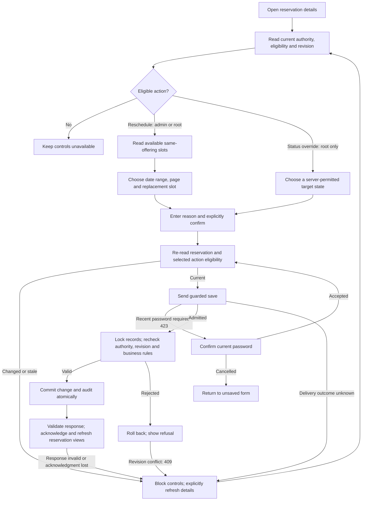

# Reservation controls — draft process tree

Draft: October 13, 2026, Asia/Tehran. Scope: the existing admin reservation detail page's reschedule and root status-override controls. This documents current behavior; it introduces no new permission, transition, UI or live operation.

The password branch permits the existing coordinator's single confirmation retry. Every attempt repeats fresh reads; the diagram's loop does not mean an unlimited retry. No automatic retry follows an uncertain delivery.

## Action rules

| Branch | Selection and authoritative checks | Result |
| --- | --- | --- |
| Reschedule | Pending with an unexpired hold, or confirmed. Choose a different, active future slot for the same doctor, workplace and checkup. Current offering/workplace/doctor eligibility and conflicting reservations are checked again under locks. Date search is bounded to 31 inclusive days and paginated. | Change the schedule, retain booked amount/currency/payment facts, append schedule history and audit in the same transaction. |
| Root override | Active root authority plus a currently permitted target from the server. Revision and transition rules are rechecked under locks. | Change lifecycle state/timestamps and commit the critical audit in the same transaction. Payment records are not marked paid by this action. |

## Root target states

| Target | Current server rule |
| --- | --- |
| Confirmed | Currently pending; hold still valid; payment summary paid and successful-attempt reference present. |
| Completed | Currently confirmed; appointment start reached. |
| Cancelled | Currently nonterminal: pending or confirmed. |
| Expired | Currently pending; no future hold. |

Completed, cancelled and expired reservations cannot be reopened through these controls. Pending and paid are not selectable override targets. Root override is a separate administrative path; ordinary assigned-doctor completion also requires its canonical successful-payment-attempt checks and records lifecycle outbox intents. Publishing a medical report does not complete an appointment.

## Cancellation and failure branches

| Event | Behavior |
| --- | --- |
| Close before save delivery | Abort reads/preflight, discard the form on close and ignore late results. |
| Cancel password confirmation | Do not retry the rejected save; return to the unsaved action form with its reason retained. |
| Close after save delivery | Abort the client request and show uncertainty. Client cancellation cannot establish that the server rolled back. |
| Session/role changes or page unmount | Abort requests and discard subject/session-bound draft state; ignore late responses. A subsequent visit reads current details. |
| Stale revision or selection | Refuse the action and require explicit refresh. |
| Known validation/permission refusal | Show refusal; a failed transaction preserves prior data. Changed authority may also close the form. |
| Network/server failure or invalid response after delivery | Treat the result as uncertain, block further actions and require explicit fresh read. |

A successful refresh establishes current state and restores current eligibility. It does not prove that a particular earlier uncertain request caused that state. The operator reassesses before initiating another action.

## Acceptance boundary

Source guards and deployed English/Farsi read-only/mouse acceptance are complete. Successful live reschedule/override saves and concurrent MySQL mutation acceptance remain separate gates. This draft neither performs those operations nor replays the completed synthetic demo.

References: [deployed controls and rollback](reservation-controls-2026-10-13.md), [server action foundation](reservation-actions-foundation-2026-10-13.md), [fresh authority guards](reservation-authority-2026-10-13.md).
